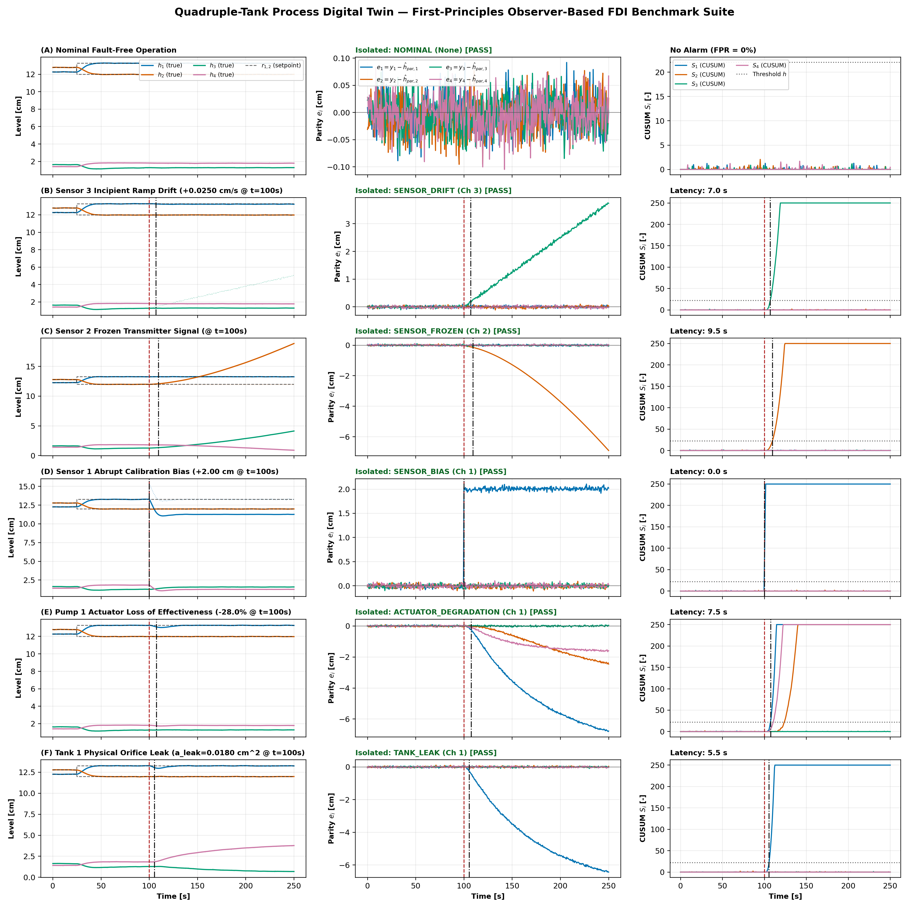
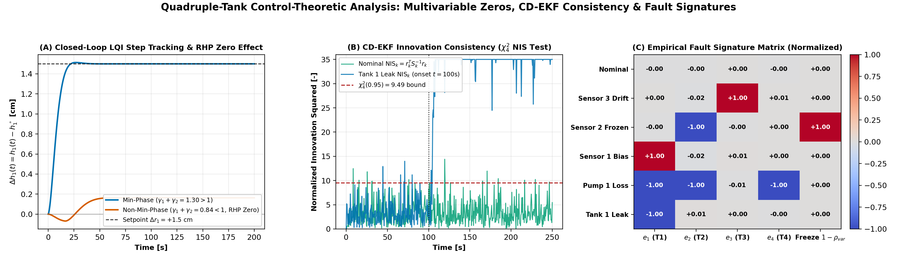

# `quadtank-fdi`: First-Principles Nonlinear Digital Twin & Observer-Based Fault Detection and Isolation (FDI)


A production-grade Python framework implementing a continuous-time nonlinear **Digital Twin**, **Multivariable Linear Quadratic Integral (LQI) Control**, **Continuous-Discrete Extended Kalman Filtering (CD-EKF)**, and **Structured Residual Fault Detection & Isolation (FDI)** for the benchmark **Johansson (2000) Quadruple-Tank Process**.

Built entirely from first principles—Bernoulli orifice differential equations, analytical Jacobian linearization, Continuous-Time Algebraic Riccati Equations (CARE), Joseph-stabilized Kalman filtering, and Analytical Redundancy Relations (ARRs)—for multivariable process control and industrial fault diagnosis.



## Key Engineering Highlights

- **Nonlinear Multivariable Plant Digital Twin (`plant.py`)**: Exact continuous-time 4-state nonlinear ODE model integrated via 4th-order Runge-Kutta (RK4), analytical equilibrium solver, exact analytical Jacobian linearization $(A, B, C)$, steady-state Relative Gain Array (RGA), and Kalman controllability/observability rank verification.
- **Closed-Loop MIMO LQI Controller (`controller.py`)**: Solves the 6-state Continuous-Time Algebraic Riccati Equation (`scipy.linalg.solve_continuous_are`) on the integral-augmented state $z = [(x - x^\circ)^T, \xi^T]^T$ with conditional clamping anti-windup on pump voltages $u \in [0, 10]\text{ V}$.
- **Realistic Physical & Instrumentation Fault Engine (`faults.py`)**: Injects incipient sensor ramp drift (`SENSOR_DRIFT`), stuck/frozen transmitter lock-up (`SENSOR_FROZEN`), abrupt calibration bias (`SENSOR_BIAS`), pump cavitation/effectiveness loss (`ACTUATOR_DEGRADATION`), and physical hull/drain leaks obeying Torricelli's law (`TANK_LEAK`).
- **CD-EKF & Structured Observer Bank (`observers.py`)**: Combines a Joseph-stabilized Continuous-Discrete Extended Kalman Filter ($\Phi_k = e^{F_k \Delta t}$, achieving pre-fault state RMSE $< 0.011\text{ cm}$ vs. $\sigma_v = 0.030\text{ cm}$ sensor noise) with an input-driven parallel reference observer whose parity residuals are invariant to closed-loop feedback compensation during sensor faults.
- **Sequential CUSUM / GLRT Detection & Directed-Graph Isolation (`fdi.py`)**: Isolates all 6 benchmark operating and fault regimes with **100% root-cause classification accuracy** and **0% false alarms** under dynamic setpoint transitions.



## 1. Benchmark Plant Physics: The Quadruple-Tank Process

The Quadruple-Tank Process (K. H. Johansson, *IEEE Trans. Control Systems Technology*, vol. 8, no. 3, pp. 456–465, May 2000) consists of four interconnected cylindrical water tanks ($i \in \{1, 2, 3, 4\}$) fed by two variable-speed pumps ($u_1, u_2 \in [0, 10]\text{ V}$) through two three-way split valves ($\gamma_1, \gamma_2 \in (0, 1)$):

- **Pump 1** delivers flow $\gamma_1 k_1 u_1$ directly into **Lower Tank 1** and $(1 - \gamma_1) k_1 u_1$ into **Upper Tank 4** (which drains via gravity into **Lower Tank 2**).
- **Pump 2** delivers flow $\gamma_2 k_2 u_2$ directly into **Lower Tank 2** and $(1 - \gamma_2) k_2 u_2$ into **Upper Tank 3** (which drains via gravity into **Lower Tank 1**).

### Nonlinear Continuous-Time State-Space ODEs

Applying mass conservation and Bernoulli's orifice outflow law ($q_{\text{out},i} = a_i \sqrt{2 g h_i}$) with optional physical leak orifice area $a_{\text{leak},i}$ yields the coupled nonlinear dynamical system on $x = [h_1, h_2, h_3, h_4]^T \in \mathbb{R}^4_+$:

$$\frac{dh_1}{dt} = -\frac{a_1 + a_{\text{leak},1}}{A_1}\sqrt{2 g h_1} + \frac{a_3}{A_1}\sqrt{2 g h_3} + \frac{\gamma_1 k_1}{A_1} u_{\text{eff},1}$$

$$\frac{dh_2}{dt} = -\frac{a_2 + a_{\text{leak},2}}{A_2}\sqrt{2 g h_2} + \frac{a_4}{A_2}\sqrt{2 g h_4} + \frac{\gamma_2 k_2}{A_2} u_{\text{eff},2}$$

$$\frac{dh_3}{dt} = -\frac{a_3 + a_{\text{leak},3}}{A_3}\sqrt{2 g h_3} + \frac{(1 - \gamma_2) k_2}{A_3} u_{\text{eff},2}$$

$$\frac{dh_4}{dt} = -\frac{a_4 + a_{\text{leak},4}}{A_4}\sqrt{2 g h_4} + \frac{(1 - \gamma_1) k_1}{A_4} u_{\text{eff},1}$$

### Analytical Linearization & Adjustable Multivariable Transmission Zero

Linearizing around an equilibrium operating point $(x^\circ, u^\circ)$ defines the tank time constants $T_i = \frac{A_i}{a_i}\sqrt{\frac{2 h_i^\circ}{g}}$ and the analytical Jacobian matrices $A = \left.\frac{\partial f}{\partial x}\right|_{(x^\circ, u^\circ)}$ and $B = \left.\frac{\partial f}{\partial u}\right|_{(x^\circ, u^\circ)}$:

$$A = \begin{bmatrix} -\frac{1}{T_1} & 0 & \frac{A_3}{A_1 T_3} & 0 \\ 0 & -\frac{1}{T_2} & 0 & \frac{A_4}{A_2 T_4} \\ 0 & 0 & -\frac{1}{T_3} & 0 \\ 0 & 0 & 0 & -\frac{1}{T_4} \end{bmatrix}, \qquad B = \begin{bmatrix} \frac{\gamma_1 k_1}{A_1} & 0 \\ 0 & \frac{\gamma_2 k_2}{A_2} \\ 0 & \frac{(1 - \gamma_2) k_2}{A_3} \\ \frac{(1 - \gamma_1) k_1}{A_4} & 0 \end{bmatrix}$$

- **Minimum-Phase Regime**: $1 < \gamma_1 + \gamma_2 < 2$ (default $\gamma_1 = 0.70, \gamma_2 = 0.60 \implies \gamma_1 + \gamma_2 = 1.30$, steady-state RGA diagonal $\Lambda_{11} = \Lambda_{22} = 1.400$).
- **Non-Minimum-Phase Regime**: $0 < \gamma_1 + \gamma_2 < 1$ (places a multivariable transmission zero in the open right-half plane, producing the inverse step response shown in Panel A above).

## 2. Closed-Loop Multivariable LQI Control with Anti-Windup

To regulate the lower tank levels $y_{\text{reg}} = [h_1, h_2]^T$ to dynamic setpoints $r_{\text{ref}}(t) = [r_1(t), r_2(t)]^T$ with zero steady-state error, we augment the state vector with the integral tracking error $\dot{\xi} = r_{\text{ref}} - C_{\text{reg}} x \in \mathbb{R}^2$:

$$z = \begin{bmatrix} x - x^\circ \\ \xi \end{bmatrix} \in \mathbb{R}^6, \qquad A_{\text{aug}} = \begin{bmatrix} A & 0_{4\times 2} \\ -C_{\text{reg}} & 0_{2\times 2} \end{bmatrix}, \qquad B_{\text{aug}} = \begin{bmatrix} B \\ 0_{2\times 2} \end{bmatrix}$$

Solving the **Continuous-Time Algebraic Riccati Equation (CARE)**:

$$A_{\text{aug}}^T P + P A_{\text{aug}} - P B_{\text{aug}} R_u^{-1} B_{\text{aug}}^T P + Q_{\text{aug}} = 0, \qquad K_{\text{aug}} = [K_x \;\; K_i] = R_u^{-1} B_{\text{aug}}^T P$$

yields the optimal state-proportional + integral feedback law with conditional clamping anti-windup:

$$u_{\text{cmd}}(t) = \text{sat}_{[u_{\min}, u_{\max}]}\!\left(u^\circ - K_x (\hat{x}(t) - x^\circ) - K_i \xi(t)\right)$$

## 3. State Estimation & Structured Observer Bank Architecture

In closed-loop industrial automation, feedback control masks physical leaks and actuator degradation by ramping pump voltages until saturation. Our diagnostic pipeline resolves this using a **Structured Observer Bank**:

1. **Continuous-Discrete Extended Kalman Filter (CD-EKF)**:
   - **Prediction**: Integrates $\dot{\hat{x}} = f(\hat{x}, u_{\text{cmd}})$ via RK4 and propagates the covariance via exact matrix-exponential discretization $\Phi_k = \exp(F_k \Delta t)$:
     $$P_{k|k-1} = \Phi_k P_{k-1|k-1} \Phi_k^T + Q \Delta t$$
   - **Update (Joseph Stabilized Form)**:
     $$r_k = y_k - H \hat{x}_{k|k-1}, \quad S_k = H P_{k|k-1} H^T + R, \quad K_k = P_{k|k-1} H^T S_k^{-1}$$
     $$\hat{x}_{k|k} = \hat{x}_{k|k-1} + K_k r_k, \quad P_{k|k} = (I - K_k H) P_{k|k-1} (I - K_k H)^T + K_k R K_k^T$$
     $$\text{NIS}_k = r_k^T S_k^{-1} r_k \sim \chi^2_4$$

2. **Input-Driven Parallel Reference Observer & Closed-Loop Invariance**:
   - Integrates $\dot{\hat{x}}_{\text{par}} = f(\hat{x}_{\text{par}}, u_{\text{cmd}})$ driven strictly by the known controller output $u_{\text{cmd}}(t)$, generating the **Primary Parity Residual Vector**:
     $$e(t) = y(t) - \hat{x}_{\text{par}}(t) \in \mathbb{R}^4$$
   - **Separation / Invariance Property**: Even when a corrupted sensor $y_i(t) = h_i(t) + f_{s,i}(t)$ causes the closed-loop LQI controller to perturb $u_{\text{cmd}}(t)$, both the physical plant and $\hat{x}_{\text{par}}(t)$ receive the exact same $u_{\text{cmd}}(t)$. Thus $h(t) - \hat{x}_{\text{par}}(t) \equiv 0$ during any sensor fault, isolating $e(t) = f_s(t) + v(t)$ strictly to the faulty sensor channel.

## 4. Fault Detection & Root-Cause Isolation Logic

### Sequential Detection: Two-Sided Page-Hinkley CUSUM & Variance Ratio Test

- **Two-Sided CUSUM** on normalized parity residuals $z_{k,i} = e_{k,i} / \sigma_v$:
  $$S_{k,i}^+ = \max(0,\, S_{k-1,i}^+ + z_{k,i} - k_{\text{slack}}), \qquad S_{k,i}^- = \max(0,\, S_{k-1,i}^- - z_{k,i} - k_{\text{slack}})$$
  $$S_{k,i} = \max(S_{k,i}^+,\, S_{k,i}^-) > h_{\text{thresh}}$$
- **Sliding-Window Innovation Variance Ratio Test** (for frozen/stuck transmitters):
  $$\rho_{\text{var}, i}(k) = \frac{\widehat{\text{Var}}(\Delta y_{k-W+1:k, i})}{2 \sigma_v^2} < \epsilon_{\text{freeze}}$$

### Directed-Graph & Dynamical Fault Signature Matrix (FSM)

| Fault Scenario | $e_1$ (Tank 1) | $e_2$ (Tank 2) | $e_3$ (Tank 3) | $e_4$ (Tank 4) | $\rho_{\text{var}, i}$ | Dynamical / Structural Discriminant |
| :--- | :---: | :---: | :---: | :---: | :---: | :--- |
| **Nominal** | $0$ | $0$ | $0$ | $0$ | $\approx 1$ | All residuals within $\pm 3\sigma_v$; $\text{NIS}_k < \chi^2_4(0.95)$ |
| **Sensor $i$ Frozen** | $\delta_{i1}$ | $\delta_{i2}$ | $\delta_{i3}$ | $\delta_{i4}$ | $\mathbf{0}$ on Ch $i$ | High-frequency variance collapses ($\rho_{\text{var}, i} \to 0$) |
| **Sensor $i$ Step Bias** | $\delta_{i1}$ | $\delta_{i2}$ | $\delta_{i3}$ | $\delta_{i4}$ | Spike | Single-sample jump $|\Delta y_i| \gg \dot{h}_{\max}\Delta t$ |
| **Sensor $i$ Ramp Drift** | $\delta_{i1}$ | $\delta_{i2}$ | $\delta_{i3}$ | $\delta_{i4}$ | $\approx 1$ | Single channel; constant slope $\dot{e}_i = \beta$ ($\ddot{e}_i \approx 0$); zero cascade to lower tank |
| **Pump 1 Degradation** | $\mathbf{< 0}$ | $< 0$ (cascade) | $0$ | $\mathbf{< 0}$ | $\approx 1$ | Coupled negative residuals on **Tanks 1 & 4** matching $B_{:,1}$ split while $e_3 = 0$ |
| **Pump 2 Degradation** | $< 0$ (cascade) | $\mathbf{< 0}$ | $\mathbf{< 0}$ | $0$ | $\approx 1$ | Coupled negative residuals on **Tanks 2 & 3** matching $B_{:,2}$ split while $e_4 = 0$ |
| **Upper Tank 3 Leak** | $\mathbf{< 0}$ | $0$ | $\mathbf{< 0}$ | $0$ | $\approx 1$ | Gravity cascade drop in **Tank 3 and Tank 1** ($e_2 = e_4 = 0$) |
| **Lower Tank 1 Leak** | $\mathbf{< 0}$ | $0$ | $0$ | $0$ | $\approx 1$ | Single lower tank; negative orifice transient with exponential damping $\dot{e}_1 = -e_1/T_1 - q_{\text{leak}}/A_1$ |

## 5. Verified Benchmark Results ($t_{\text{onset}} = 100.0\text{ s}$, $\Delta t = 0.5\text{ s}$)

| Scenario | Injected Fault & Channel | Detection Latency | Isolated Root Cause | Pre-Fault EKF RMSE | Verdict |
| :--- | :--- | :--- | :--- | :--- | :--- |
| **`nominal`** | Fault-free (+setpoint step at $t=25\text{ s}$) | None ($0\text{ FA}$) | `nominal` (None) | $0.0110\text{ cm}$ | **PASS** |
| **`sensor_drift`** | Sensor 3 ramp drift ($+0.025\text{ cm/s}$) | $7.0\text{ s}$ | `sensor_drift` (Ch 3) | $0.0102\text{ cm}$ | **PASS** |
| **`sensor_frozen`** | Sensor 2 stuck transmitter ($y_2(t) = y_2(100\text{ s})$) | $9.5\text{ s}$ | `sensor_frozen` (Ch 2) | $0.0099\text{ cm}$ | **PASS** |
| **`sensor_bias`** | Sensor 1 step bias ($+2.00\text{ cm}$) | $0.0\text{ s}$ | `sensor_bias` (Ch 1) | $0.0100\text{ cm}$ | **PASS** |
| **`actuator_degradation`** | Pump 1 loss of effectiveness ($-28\%$, $\tau=5\text{ s}$) | $7.5\text{ s}$ | `actuator_degradation` (Ch 1) | $0.0097\text{ cm}$ | **PASS** |
| **`tank_leak`** | Tank 1 orifice leak ($a_{\text{leak}} = 0.018\text{ cm}^2$) | $5.5\text{ s}$ | `tank_leak` (Ch 1) | $0.0103\text{ cm}$ | **PASS** |

## 6. Repository Layout & Quickstart

```text
quadtank-fdi/
├── .github/workflows/ci.yml           # Automated GitHub Actions CI across Python 3.10-3.12
├── docs/assets/
│   ├── quad_tank_fdi_diagnostics.png  # 6-scenario diagnostic telemetry suite
│   ├── control_theory_analysis.png    # RHP zero, NIS chi^2_4 & Fault Signature heatmap
│   └── quad_tank_fdi_benchmark_metrics.csv
├── src/quadtank_fdi/
│   ├── __init__.py                    # Public package exports
│   ├── plant.py                       # Nonlinear ODEs, RK4 integrator, analytical Jacobians, RGA
│   ├── controller.py                  # Continuous-time CARE solver & MIMO LQI anti-windup controller
│   ├── faults.py                      # First-principles fault injection engine
│   ├── observers.py                   # Continuous-Discrete EKF & Structured Parallel/Cascade Bank
│   ├── fdi.py                         # Two-sided CUSUM, GLRT, variance ratio & isolation rules
│   ├── simulator.py                   # Closed-loop simulation runner & telemetry evaluation
│   ├── plotting.py                    # Publication-grade multi-scenario diagnostic visualization
│   └── cli.py                         # Command-line interface & CSV/console reporting
├── tests/
│   ├── test_plant_and_control.py      # Physics, finite-difference Jacobians, RGA, Kalman ranks, LQI
│   └── test_fdi_pipeline.py           # End-to-end EKF accuracy & multi-scenario isolation tests
├── .gitignore
├── LICENSE
├── Makefile
├── pyproject.toml
├── requirements.txt
└── README.md
```

### Installation & Execution

```bash
# 1. Install package in editable mode with test dependencies
pip install -e ".[dev]"

# 2. Run automated unit & integration tests (supports both pytest and unittest)
pytest
# or:
PYTHONPATH=src python3 -m unittest discover -s tests -v

# 3. Run the end-to-end 6-scenario FDI benchmark and generate plots + CSV telemetry
quadtank-fdi --output-dir outputs
```
